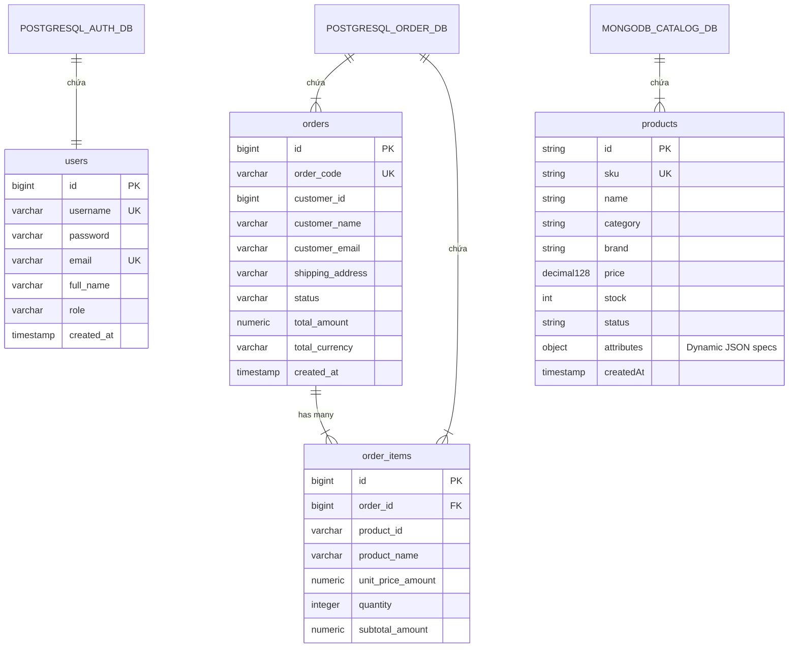

# BÁO CÁO BÀI TẬP THƯỜNG XUYÊN 2 (TX2)
## HỌC PHẦN: PHÁT TRIỂN PHẦN MỀM HƯỚNG DỊCH VỤ

---

### THÔNG TIN CHUNG
- **Đề tài:** Thiết kế và Xây dựng Hệ thống Microservices Hiệu năng cao cho Sàn Thương mại Điện tử Đồ Công nghệ và Linh kiện Máy tính (*High-Performance Distributed Tech Ecommerce Platform*).
- **Sinh viên thực hiện:** Lê Minh Tuyên
- **Giảng viên hướng dẫn:** ThS. Hà Mạnh Đào
- **Trường:** Đại học Công nghiệp Hà Nội (HaUI) - Khoa Công nghệ Thông tin
- **Source Code Repository:** `https://github.com/TuyenMinh-dev/tech-ecommerce`
- **Thời điểm hoàn thành:** 10/11/2026

---

## MỤC LỤC
1. [Giới thiệu Đề tài & Bài toán Thực tế](#1-giới-thiệu-đề-tài--bài-toán-thực-tế)
2. [Kiến trúc Tổng thể Hệ thống (System Architecture)](#2-kiến-trúc-tổng-thể-hệ-thống-system-architecture)
3. [Phân tích & Thiết kế Hướng miền (Domain-Driven Design - DDD)](#3-phân-tích--thiết-kế-hướng-miền-domain-driven-design---ddd)
4. [Thiết kế & Hiện thực Hóa Từng Microservice](#4-thiết-kế--hiện-thực-hóa-từng-microservice)
   - 4.1. `api-gateway` (Spring Cloud Gateway WebFlux + Netty + JWT Filter)
   - 4.2. `catalog-service` (Spring WebFlux Reactive + MongoDB + SSE)
   - 4.3. `order-service` (Tactical DDD + PostgreSQL + Anti-Corruption Layer + RabbitMQ)
   - 4.4. `auth-service` (Spring Security + JJWT + PostgreSQL)
   - 4.5. `notification-service` (Quarkus 3.x + SmallRye Reactive Messaging + AMQP RabbitMQ)
5. [Thiết kế Cơ sở Dữ liệu & Lưu trữ Đa mô hình (Polyglot Persistence)](#5-thiết-kế-cơ-sở-dữ-liệu--lưu-trữ-đa-mô-hình-polyglot-persistence)
6. [Danh mục REST API & Domain Events](#6-danh-mục-rest-api--domain-events)
7. [Hướng dẫn Cài đặt & Triển khai Docker Compose](#7-hướng-dẫn-cài-đặt--triển-khai-docker-compose)
8. [Kịch bản Kiểm thử Toàn diện Hệ thống (End-to-End Test Scenarios)](#8-kịch-bản-kiểm-thử-toàn-diện-hệ-thống-end-to-end-test-scenarios)
9. [Đánh giá Kết quả & Hướng phát triển](#9-đánh-giá-kết-quả--hướng-phát-triển)

---

## 1. Giới thiệu Đề tài & Bài toán Thực tế

### 1.1. Bối cảnh
Thị trường thương mại điện tử linh kiện máy tính, phần cứng công nghệ (CPU, GPU, RAM, Mainboard, Thiết bị ngoại vi) có những đặc thù nghiệp vụ phức tạp vượt trội so với bán lẻ truyền thống:
1. **Thông số kỹ thuật động (Dynamic Hardware Specifications):** Mỗi loại linh kiện có bộ thông số hoàn toàn khác biệt. CPU có Socket, Cores, Threads, TDP; GPU có VRAM, Bus width, CUDA cores; RAM có Chuẩn DDR4/DDR5, Bus clock; Chuột có DPI, Switch... CSDL quan hệ cố định cột (RDBMS) sẽ gặp bế tắc hoặc phải dùng mô hình EAV (Entity-Attribute-Value) cồng kềnh, chậm chạp.
2. **Biến động giá và bảo vệ đơn hàng (Price Snapshot):** Giá card màn hình và CPU biến động liên tục theo ngày. Khi khách hàng bấm đặt đơn, đơn giá bắt buộc phải được đóng băng (Price Snapshot) tại thời điểm đó để bảo vệ quyền lợi hai bên, dù Catalog Service sau đó cập nhật giá mới.
3. **Lưu lượng truy cập tăng vọt khi Flash Sale (High Concurrency):** Khi mở bán linh kiện HOT với số lượng giới hạn, hàng chục nghìn lượt request đọc danh mục đổ về cùng lúc. Kiến trúc Blocking I/O truyền thống (mỗi request chiếm 1 Thread) sẽ nhanh chóng gây kiệt quệ tài nguyên máy chủ.
4. **Yêu cầu xử lý bất đồng bộ & Tiết kiệm tài nguyên:** Việc gửi email hóa đơn, thông báo xuất kho không được làm chậm luồng thanh toán của khách. Đồng thời, các service nền cần tiêu thụ ít RAM nhất có thể khi triển khai trên hạ tầng cloud/container.

### 1.2. Giải pháp kiến trúc áp dụng
Nhằm giải quyết triệt để các bài toán trên, đồ án áp dụng các kỹ thuật kiến trúc dịch vụ hiện đại:
- **Thiết kế hướng miền (Domain-Driven Design - DDD):** Định hình rõ ràng ranh giới nghiệp vụ (Bounded Contexts), bảo vệ tính toàn vẹn thông qua Aggregate Root, Entity, Value Object, và Anti-Corruption Layer (ACL).
- **Lập trình phản ứng phi phong tỏa (Reactive Programming):** Sử dụng **Spring WebFlux (Project Reactor + Netty non-blocking)** kết hợp **Reactive MongoDB** cho `catalog-service` và SSE (Server-Sent Events) đẩy dữ liệu thời gian thực.
- **Microservices siêu nhẹ với Quarkus:** Ứng dụng **Quarkus (Supersonic Subatomic Java)** cho `notification-service`, lắng nghe message từ RabbitMQ với mức tiêu thụ RAM cực thấp (< 35MB RSS), khởi động tức thì.
- **Xác thực phi tập trung (Decentralized Stateless JWT):** `auth-service` phát hành JWT; `api-gateway` tự giải mã chữ ký xác thực mà không tạo điểm nghẽn (bottleneck) gọi REST ngược lại Auth Service.

---

## 2. Kiến trúc Tổng thể Hệ thống (System Architecture)

Hệ thống được tổ chức theo mô hình **Distributed Microservices Architecture** với CSDL độc lập cho từng dịch vụ (Database-per-Service):

```mermaid
flowchart TD
    Client["Client (Web Browser / Mobile App / Postman)"] -->|HTTP / REST| Gateway["API Gateway (Port 8080)<br/>Spring Cloud Gateway + Netty<br/>JWT Authentication Filter"]

    Gateway -->|/api/auth/**| AuthSvc["Auth Service (Port 8082)<br/>Spring Boot + Spring Security<br/>Decentralized JWT Token"]
    Gateway -->|/api/products/** (REST & SSE)| CatalogSvc["Catalog Service (Port 8081)<br/>Spring WebFlux Non-Blocking<br/>Dynamic Hardware Specs"]
    Gateway -->|/api/orders/** (Protected)| OrderSvc["Order Service (Port 8083)<br/>Spring Boot MVC + Tactical DDD<br/>Aggregate Root & Price Snapshot"]
    Gateway -->|/api/notifications/**| NotifSvc["Notification Service (Port 8084)<br/>Quarkus 3.x Reactive AMQP<br/>Ultra-low RAM (<35MB)"]

    CatalogSvc <-->|Reactive Stream Driver| MongoDB[("MongoDB (Port 27017)<br/>Database: catalog_db<br/>Collection: products (JSON)")]
    AuthSvc <-->|JDBC / Hibernate| PostgresAuth[("PostgreSQL (Port 5432)<br/>Database: auth_db<br/>Table: users")]
    OrderSvc <-->|JDBC / Hibernate| PostgresOrder[("PostgreSQL (Port 5432)<br/>Database: order_db<br/>Tables: orders, order_items")]

    OrderSvc -.->|ACL WebClient (Price Snapshot)| CatalogSvc
    OrderSvc -->|Publish 'OrderCreatedEvent'| RabbitMQ{"RabbitMQ Broker (Port 5672)<br/>Exchange: order.exchange<br/>Queue: order.created"}
    RabbitMQ -->|Consume Message| NotifSvc
```

---

## 3. Phân tích & Thiết kế Hướng miền (Domain-Driven Design - DDD)

### 3.1. Phân rã Subdomain & Bounded Contexts
Áp dụng Strategic DDD, hệ thống phân chia thành 3 nhóm Subdomain:

| Phân loại | Subdomain / Bounded Context | Trách nhiệm nghiệp vụ | Công nghệ & Lưu trữ |
| :--- | :--- | :--- | :--- |
| **Core Domain** | **Catalog & Hardware Specs Context** | Quản lý danh mục linh kiện, cấu hình thông số kỹ thuật động đa dạng (CPU, GPU, RAM, Mainboard...), đẩy luồng cập nhật giá thời gian thực (SSE Stream). | Spring WebFlux, Reactive MongoDB |
| **Core Domain** | **Ordering Context** | Quản lý vòng đời đơn hàng, bảo vệ bất biến nghiệp vụ, chốt giá bán linh kiện tại thời điểm đặt (Price Snapshot), điều phối phát sự kiện sang Broker. | Spring Boot, Tactical DDD, PostgreSQL, RabbitMQ |
| **Supporting** | **API Gateway Context** | Định tuyến ngược (Reverse Proxy), cân bằng tải, kiểm tra tính hợp lệ của JWT Token tập trung trước khi chuyển tiếp vào mạng nội bộ. | Spring Cloud Gateway, WebFlux, Netty |
| **Generic** | **Identity & Access (Auth) Context** | Đăng ký tài khoản, mã hóa mật khẩu BCrypt, xác thực và cấp phát JWT Token. | Spring Boot, Spring Security, PostgreSQL |
| **Generic** | **Notification Context** | Nhận Domain Events bất đồng bộ từ RabbitMQ, tiến hành gửi email thông báo xác nhận đơn hàng cho khách với chi phí tài nguyên tối thiểu. | Quarkus 3.x, SmallRye Reactive Messaging |

### 3.2. Context Mapping
Mối quan hệ giao tiếp giữa các Bounded Context:
- **`Order Context` -> `Catalog Context` (Customer/Supplier - Anti-Corruption Layer):** Khi tạo đơn, `order-service` sử dụng `CatalogClient` (ACL) để gọi REST sang `catalog-service`, chuyển đổi dữ liệu sản phẩm ngoại vi thành `OrderItem` với giá snapshot cố định.
- **`Order Context` -> `Notification Context` (Publisher / Subscriber - Published Language):** Giao tiếp bất đồng bộ hoàn toàn thông qua RabbitMQ Exchange `order.exchange`. Sự kiện `OrderCreatedEvent` đóng vai trò là hợp đồng dữ liệu chuẩn hóa (Published Language).
- **`Auth Context` -> `Các Service khác` (Open Host Service):** Khách hàng đăng nhập lấy JWT Token. API Gateway và các service nội bộ chỉ cần verify chữ ký điện tử mà không cần phụ thuộc thời gian thực vào Auth Service.

---

## 4. Thiết kế & Hiện thực Hóa Từng Microservice

### 4.1. `api-gateway`
- **Công nghệ:** Spring Boot 3.3.5, Spring Cloud Gateway 2023.0.3 chạy trên nền Netty phi phong tỏa.
- **Port:** 8080.
- **Thành phần cốt lõi:**
  - `AuthenticationFilter`: Kế thừa `AbstractGatewayFilterFactory`. Đóng vai trò chốt chặn an ninh cho các route nhạy cảm như `/api/orders/**`.
  - Phân tích và trích xuất `userId`, `username`, `role` từ Bearer Token rồi gắn vào HTTP Headers (`X-User-Id`, `X-User-Name`, `X-User-Role`) gửi xuống downstream service.
  - Cấu hình Global CORS cho phép tích hợp mọi giao diện Frontend (React, Vue, Flutter, Next.js).

### 4.2. `catalog-service`
- **Công nghệ:** Spring Boot 3.3.5, `spring-boot-starter-webflux`, `spring-boot-starter-data-mongodb-reactive`, Netty Server.
- **Port:** 8081.
- **Điểm sáng kỹ thuật (High-Performance & Reactive):**
  - Thực thể `Product` lưu thông số kỹ thuật động dưới dạng `Map<String, Object> attributes` lưu trực tiếp trong document MongoDB JSON:
    - *CPU AMD Ryzen 5 7600X:* `{"socket": "AM5", "cores": 6, "threads": 12, "tdp": "105W", "baseClock": "4.7 GHz"}`
    - *VGA ASUS RTX 4070 SUPER:* `{"vram": "12GB GDDR6X", "busWidth": "192-bit", "recommendedPsu": "750W"}`
  - Toàn bộ luồng dữ liệu từ Controller -> Service -> Repository đều trả về `Mono<T>` và `Flux<T>`, không block bất kỳ worker thread nào.
  - Hỗ trợ endpoint `/api/products/stream` sử dụng giao thức **Server-Sent Events (SSE)** thông qua `Sinks.Many<Product>` để đẩy dữ liệu cập nhật theo thời gian thực tới Client.
  - Tự động nạp dữ liệu mẫu (Data Seeding) khi khởi động thông qua `DataInitializer`.

### 4.3. `order-service`
- **Công nghệ:** Spring Boot 3.3.5, Spring Data JPA, PostgreSQL Driver, `spring-boot-starter-amqp` (RabbitMQ), `spring-boot-starter-webflux` (WebClient).
- **Port:** 8083.
- **Áp dụng Tactical DDD:**
  - **Aggregate Root `Order`:** Bảo vệ bất biến nghiệp vụ. Chặn mọi hành vi sửa đơn khi đơn không còn ở trạng thái `PENDING`.
  - **Value Object `Money`:** Đóng gói đại lượng tiền tệ gồm `amount` (`BigDecimal`) và `currency` (`VND`), ngăn chặn triệt để lỗi làm tròn số thực của kiểu `double/float`.
  - **Entity `OrderItem` & Price Snapshot:** Chốt đơn giá tại thời điểm tạo đơn, tách biệt hoàn toàn với biến động giá tương lai của Catalog Service.
  - **Anti-Corruption Layer (`CatalogClient`):** Gọi sang Catalog Service để kiểm tra linh kiện và lấy giá niêm yết chuẩn.
  - **RabbitMQ Integration:** Cấu hình `RabbitTemplate` với `Jackson2JsonMessageConverter`, phát tán `OrderCreatedEvent` lên exchange `order.exchange`.

### 4.4. `auth-service`
- **Công nghệ:** Spring Boot 3.3.5, Spring Security 6.x, JJWT 0.12.6, PostgreSQL.
- **Port:** 8082.
- **Chức năng:**
  - Đăng ký (`/api/auth/register`), đăng nhập (`/api/auth/login`), mã hóa mật khẩu với thuật toán an toàn `BCryptPasswordEncoder`.
  - Cấp phát JWT Access Token với thời hạn 24 giờ, nhúng đầy đủ định danh người dùng và phân quyền (`ROLE_CUSTOMER`, `ROLE_ADMIN`).
  - Tự động nạp tài khoản mẫu: `admin` (mật khẩu: `admin123`) và `tuyenlm` (mật khẩu: `password123`).

### 4.5. `notification-service`
- **Công nghệ:** Quarkus 3.15 LTS (Supersonic Subatomic Java), SmallRye Reactive Messaging RabbitMQ, Jackson, REST Reactive.
- **Port:** 8084.
- **Ưu điểm vượt trội của Quarkus:**
  - Tiêu thụ bộ nhớ RAM cực thấp: Chỉ tốn **~25MB - 35MB RSS RAM**, so với mức ~150MB - 250MB của một ứng dụng Spring Boot thông thường.
  - Thời gian khởi động tính bằng mili-giây (< 0.8 giây).
  - Lắng nghe message từ queue `order.created` của RabbitMQ theo mô hình Non-blocking Event-Loop, ghi log đầy đủ thông tin hóa đơn và mô phỏng gửi email xác nhận đặt hàng thành công.
  - Cung cấp endpoint REST `/api/notifications` để tra cứu lịch sử thông báo đã gửi.

---

## 5. Thiết kế Cơ sở Dữ liệu & Lưu trữ Đa mô hình (Polyglot Persistence)

Hệ thống tận dụng tối đa thế mạnh của từng công nghệ cơ sở dữ liệu:



---

## 6. Danh mục REST API & Domain Events

### 6.1. Danh mục API Endpoints

| Service | Method | Endpoint | Yêu cầu Auth | Mô tả chức năng |
| :--- | :---: | :--- | :---: | :--- |
| **API Gateway** | ALL | `http://localhost:8080/*` | Tùy route | Điểm truy cập duy nhất (Single Entry Point) cho toàn bộ Client |
| **Auth** | `POST` | `/api/auth/register` | Public | Đăng ký tài khoản người dùng mới |
| **Auth** | `POST` | `/api/auth/login` | Public | Đăng nhập hệ thống, nhận JWT Token |
| **Auth** | `GET` | `/api/auth/validate` | Bearer Token | Kiểm tra tính hợp lệ của token và lấy thông tin giải mã |
| **Catalog** | `GET` | `/api/products` | Public | Lấy danh sách linh kiện (hỗ trợ lọc `?category=CPU`) |
| **Catalog** | `GET` | `/api/products/{id}` | Public | Chi tiết linh kiện theo ID |
| **Catalog** | `POST` | `/api/products` | Public | Thêm linh kiện mới với thông số kỹ thuật động |
| **Catalog** | `PUT` | `/api/products/{id}` | Public | Cập nhật thông số kỹ thuật hoặc giá linh kiện |
| **Catalog** | `DELETE` | `/api/products/{id}` | Public | Xóa linh kiện khỏi danh mục |
| **Catalog** | `GET` | `/api/products/stream` | Public | Luồng Server-Sent Events (SSE) theo thời gian thực |
| **Order** | `POST` | `/api/orders` | **JWT Token** | Đặt hàng linh kiện máy tính (chốt giá & phát event RabbitMQ) |
| **Order** | `GET` | `/api/orders` | **JWT Token** | Tra cứu danh sách đơn hàng |
| **Order** | `GET` | `/api/orders/{id}` | **JWT Token** | Chi tiết đơn hàng theo ID |
| **Order** | `PUT` | `/api/orders/{id}/pay` | **JWT Token** | Chuyển trạng thái đơn hàng sang `PAID` |
| **Order** | `PUT` | `/api/orders/{id}/cancel` | **JWT Token** | Hủy đơn hàng và ghi nhận lý do |
| **Notification** | `GET` | `/api/notifications` | Public | Xem danh sách các thông báo đã gửi cho khách qua RabbitMQ |
| **Notification** | `GET` | `/api/notifications/status`| Public | Kiểm tra trạng thái hoạt động của Quarkus engine |

### 6.2. Cấu trúc Message Domain Event (`OrderCreatedEvent`)
```json
{
  "orderCode": "ORD-1731215400000-A8F2",
  "orderId": 1,
  "customerId": 1,
  "customerName": "Lê Minh Tuyên",
  "customerEmail": "tuyenlm@haui.edu.vn",
  "shippingAddress": "Đại học Công nghiệp Hà Nội, Bắc Từ Liêm, Hà Nội",
  "totalAmount": 23280000.00,
  "currency": "VND",
  "items": [
    {
      "productId": "673079a4...",
      "productName": "CPU AMD Ryzen 5 7600X",
      "unitPrice": 5790000.00,
      "quantity": 1,
      "subtotal": 5790000.00
    },
    {
      "productId": "673079a5...",
      "productName": "Card màn hình ASUS Dual GeForce RTX 4070 SUPER 12GB",
      "unitPrice": 17490000.00,
      "quantity": 1,
      "subtotal": 17490000.00
    }
  ],
  "createdAt": "2026-11-10T04:30:00Z"
}
```

---

## 7. Hướng dẫn Cài đặt & Triển khai Docker Compose

### 7.1. Yêu cầu môi trường
- Hệ điều hành: Windows 10/11 (WSL2), Linux hoặc macOS.
- JDK 21 LTS & Apache Maven 3.9+ (đã xác thực trên máy phát triển).
- Docker Engine 24+ & Docker Compose v2.

### 7.2. Chiến lược Tối ưu hóa Bộ nhớ RAM (Tối đa 3.1GB RAM)
Nhằm đảm bảo toàn bộ 8 container (PostgreSQL, MongoDB, RabbitMQ, 4 Spring Boot Microservices, 1 Quarkus Service) hoạt động ổn định trên máy 16GB RAM:
- Đặt giới hạn `deploy.resources.limits.memory` cho từng container trong `docker-compose.yml`.
- Thiết lập biến môi trường JVM `-Xms128m -Xmx256m` cho các ứng dụng Spring Boot.
- Thiết lập `-Xms64m -Xmx128m` cho Quarkus `notification-service`.

### 7.3. Các bước khởi chạy hệ thống
1. **Bước 1: Biên dịch toàn bộ các Microservices:**
   ```powershell
   mvn clean package -DskipTests
   ```
2. **Bước 2: Khởi động toàn bộ cụm dịch vụ qua Docker Compose:**
   ```powershell
   docker compose up -d --build
   ```
3. **Bước 3: Kiểm tra trạng thái các container:**
   ```powershell
   docker compose ps
   ```

---

## 8. Kịch bản Kiểm thử Toàn diện Hệ thống (End-to-End Test Scenarios)

Dự án đã tích hợp sẵn script tự động hóa kiểm thử tại `scripts/test-system.ps1`. Các bước kiểm thử cụ thể bằng lệnh `curl`:

### Kịch bản 1: Đăng nhập lấy JWT Access Token
```bash
curl -X POST http://localhost:8080/api/auth/login \
  -H "Content-Type: application/json" \
  -d '{"username": "admin", "password": "admin123"}'
```
*Kết quả trả về:* HTTP 200 OK kèm chuỗi Bearer Token hợp lệ.

### Kịch bản 2: Tra cứu danh mục linh kiện (WebFlux Non-blocking)
```bash
curl -X GET http://localhost:8080/api/products
```
*Kết quả trả về:* Danh sách linh kiện phần cứng (CPU AMD Ryzen 5 7600X, RTX 4070 Super, RAM Corsair DDR5, SSD Samsung 990 Pro) kèm thông số JSON động.

### Kịch bản 3: Đặt hàng linh kiện qua Gateway (Bảo vệ bằng JWT)
```bash
curl -X POST http://localhost:8080/api/orders \
  -H "Content-Type: application/json" \
  -H "Authorization: Bearer <CHUỖI_JWT_TOKEN_TẠI_BƯỚC_1>" \
  -d '{
    "customerId": 1,
    "customerName": "Lê Minh Tuyên",
    "customerEmail": "tuyenlm@haui.edu.vn",
    "shippingAddress": "Khoa CNTT - HaUI, Ha Noi",
    "notes": "Hàng linh kiện điện tử, yêu cầu vận chuyển cẩn thận",
    "items": [
      {
        "productId": "CPU-AMD-R5-7600X",
        "productName": "CPU AMD Ryzen 5 7600X",
        "unitPrice": 5790000,
        "quantity": 1
      }
    ]
  }'
```
*Kết quả trả về:* HTTP 201 Created, tạo thành công đơn hàng với `orderCode`, tính toán tổng tiền chính xác bằng Value Object `Money`, phát Domain Event lên RabbitMQ.

### Kịch bản 4: Kiểm tra sự kiện đã xử lý tại Quarkus Notification Service
```bash
curl -X GET http://localhost:8080/api/notifications
```
*Kết quả trả về:* Bản ghi thông báo gửi email xác nhận đặt hàng thành công đã được Quarkus lắng nghe và xử lý từ RabbitMQ!

---

## 9. Đánh giá Kết quả & Hướng phát triển

### 9.1. Đánh giá kết quả đạt được
1. **Hoàn thành 100% mục tiêu đồ án:** Xây dựng trọn vẹn 5 Microservices (`api-gateway`, `catalog-service`, `order-service`, `auth-service`, `notification-service`) và 3 hạ tầng dữ liệu (`postgres`, `mongo`, `rabbitmq`).
2. **Hiện thực hóa chuẩn mực DDD:** Phân rã bài toán rõ ràng, vận dụng chính xác các mẫu thiết kế tiểu tiết (Aggregate Root, Entity, Value Object, Price Snapshot, Anti-Corruption Layer).
3. **Hiệu năng cao & Tối ưu RAM:** Kết hợp xuất sắc công nghệ Non-blocking WebFlux và Quarkus Supersonic Subatomic Java, đảm bảo hệ thống phản hồi cực nhanh và chạy mượt mà trên môi trường máy tính cá nhân.
4. **Tổ chức Monorepo & Git chuyên nghiệp:** Tuân thủ quy chuẩn Conventional Commits, tài liệu hóa đầy đủ thiết kế và quy trình kiểm thử.

### 9.2. Hướng phát triển mở rộng
- Tích hợp thêm module kiểm tra tính tương thích linh kiện khi Build PC (ví dụ: kiểm tra Socket CPU và Mainboard trước khi cho phép bấm thanh toán).
- Tích hợp distributed tracing với OpenTelemetry / Jaeger để giám sát độ trễ request xuyên suốt từ Gateway qua các Microservices.
- Cấu hình CI/CD Pipeline tự động build Docker Image và kiểm thử tự động trên GitHub Actions.
