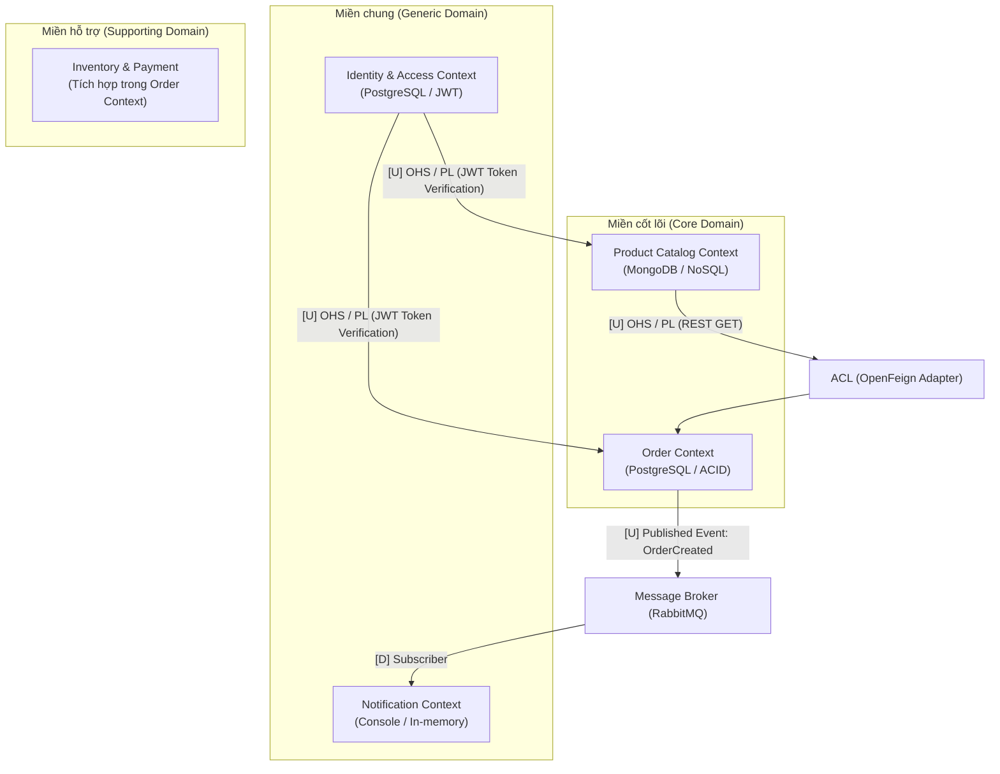

# PHÂN TÍCH & THIẾT KẾ HỆ THỐNG THEO DOMAIN-DRIVEN DESIGN (DDD)
## DỰ ÁN: SÀN THƯƠNG MẠI ĐIỆN TỬ ĐỒ CÔNG NGHỆ (TECH-ECOMMERCE)

### 1. Phân rã Domain & Subdomain (Domain Decomposition)

| Loại Subdomain | Tên Subdomain | Mục đích nghiệp vụ cụ thể với Sàn đồ công nghệ | Service tương ứng | CSDL dự kiến |
| :--- | :--- | :--- | :--- | :--- |
| **Core Domain** | **Catalog & Product Specs** | - Quản lý danh mục linh kiện với bộ thông số kỹ thuật động đa dạng theo từng loại (CPU có Socket/Xung nhịp, RAM có Bus/Chuẩn DDR4-DDR5, Chuột có DPI/Switch...). - Hỗ trợ tìm kiếm, lọc đa tiêu chí theo cấu hình phần cứng. - **Quy tắc nghiệp vụ:** Kiểm tra tính tương thích linh kiện khi người dùng tự "Build PC" (ví dụ: CPU chuẩn Socket AM5 bắt buộc phải đi cùng Mainboard hỗ trợ AM5 và RAM DDR5). | `catalog-service` | MongoDB *(Lưu JSON động cho thông số kỹ thuật)* |
| **Core Domain** | **Ordering & Checkout** | - Quản lý giỏ hàng, tạo đơn đặt hàng và điều phối vòng đời trạng thái đơn hàng (`Pending` -> `Confirmed` -> `Paid` -> `Shipping` -> `Completed` / `Cancelled`). - Tính toán tổng tiền, phí vận chuyển và kiểm tra điều kiện áp mã giảm giá / khuyến mãi đi kèm (mua kèm giảm thêm - Bundle Deal). - **Quy tắc nghiệp vụ:** Chốt giá bán (Price Snapshot) tại thời điểm bấm đặt hàng (nếu sau đó `catalog-service` tăng giá linh kiện thì đơn đã đặt không bị đổi giá); tự động hủy đơn nếu quá 15 phút chưa thanh toán. | `order-service` | PostgreSQL *(Đảm bảo tính toàn vẹn giao dịch ACID)* |
| **Supporting** | **Inventory (Quản lý Kho & Serial)** | - Theo dõi số lượng tồn kho thực tế (`Available Stock`) và số lượng đang giữ chỗ tạm thời (`Reserved Stock`) cho từng mã SKU linh kiện. - Quản lý mã **Serial Number / IMEI** của từng linh kiện xuất kho để phục vụ tra cứu bảo hành chính hãng. - **Quy tắc nghiệp vụ:** Không cho phép tồn kho khả dụng âm (chống bán lố - Overselling khi Flash Sale card đồ họa/CPU); giữ hàng tạm thời khi đơn hàng vừa tạo, trừ kho thật khi thanh toán thành công và hoàn lại tồn kho nếu đơn hàng bị hủy. | `order-service` *(hoặc tách `inventory-service` riêng)* | PostgreSQL |
| **Supporting** | **Payment (Thanh toán)** | - Xử lý giao dịch thu tiền đơn hàng (Thanh toán trả trước qua cổng thanh toán/QR Code hoặc COD - thu hộ khi nhận hàng). - Ghi nhận lịch sử giao dịch (`Transaction Log`) và đối soát trạng thái thanh toán. - **Quy tắc nghiệp vụ:** Số tiền thanh toán phải khớp 100% với tổng tiền đơn hàng; các đơn hàng "Build PC" nguyên bộ hoặc giá trị cao (ví dụ > 20 triệu VNĐ) bắt buộc phải thanh toán trước hoặc đặt cọc tối thiểu 10% mới được xác nhận xuất kho; xử lý hoàn tiền (`Refund`) khi đơn đã trả tiền bị hủy. | `order-service` *(module giả lập thanh toán)* | PostgreSQL |
| **Generic** | **Identity & Access (Auth)** | - Quản lý đăng ký, đăng nhập, xác thực người dùng bằng JWT (Access Token & Refresh Token). - Phân quyền truy cập theo vai trò (`Customer` mua hàng, `Staff` quản lý kho/đơn, `Admin` quản trị hệ thống) và lưu sổ địa chỉ nhận hàng. - **Quy tắc nghiệp vụ:** Mật khẩu phải được băm (Hash) trước khi lưu; tài khoản bị khóa hoặc chưa kích hoạt không được phép tạo đơn hàng; mỗi người dùng có tối đa 1 địa chỉ nhận hàng mặc định. | `auth-service` | PostgreSQL |
| **Generic** | **Notification (Thông báo)** | - Lắng nghe các sự kiện nghiệp vụ (`Domain Events`) từ các service khác (qua Message Broker) để gửi thông báo tự động cho khách hàng qua Email/SMS/Console. - **Quy tắc nghiệp vụ:** Gửi thông báo xác nhận ngay khi phát sinh sự kiện `OrderCreated`, gửi hóa đơn điện tử kèm danh sách Serial bảo hành khi `OrderPaid`, và gửi cảnh báo khi đơn hàng bị hủy. Cơ chế gửi tin hoạt động bất đồng bộ: nếu lỗi gửi mail không được làm gián đoạn luồng đặt hàng của khách. | `notification-service` | In-memory / Console *(hoặc Redis)* |

### 2. Bounded Contexts & Ubiquitous Language (Ngôn ngữ chung)
Dưới đây là cách cùng một thực thể được mô hình hóa khác nhau qua các ranh giới ngữ cảnh (Bounded Context):
| Khái niệm nghiệp vụ | Trong Product Catalog Context (`catalog-service`) | Trong Order Context (`order-service`) | Trong Inventory Context (`inventory`) |
| :--- | :--- | :--- | :--- |
| **Sản phẩm (Product)** | **`ProductCatalogItem` (Aggregate Root)** - Quản lý: Tên, Hãng sản xuất, Mô tả, Dynamic Attributes (JSON Specs), Hình ảnh. - Hành động: `PublishProduct()`, `UpdateSpecs()`. | **`OrderItemSnapshot` (Value Object)** - Quản lý: `ProductId`, `ProductName`, `UnitPrice` (giá tại thời điểm mua), `Quantity`. - Không chứa thuộc tính kỹ thuật chi tiết. | **`StockItem` (Entity / Aggregate)** - Quản lý: `SkuCode`, `AvailableQuantity`, `ReservedQuantity`, Danh sách `SerialNumber` tồn kho. - Hành động: `ReserveStock()`, `ReleaseStock()`, `DeductStock()`. |
| **Người dùng (User)** | **Khách xem hàng (Guest/Viewer)** - Chỉ đọc dữ liệu, lọc linh kiện. | **`Customer` (Value Object)** - `CustomerId`, Địa chỉ giao hàng (`ShippingAddress`), Số điện thoại nhận hàng. | **Nhân viên kho (Warehouse Keeper)** - Người quét mã vạch xuất/nhập kho. |
| **Trạng thái cốt lõi** | Trạng thái hiển thị sản phẩm: `DRAFT`, `PUBLISHED`, `DISCONTINUED`. | Vòng đời đơn hàng: `PENDING`, `CONFIRMED`, `PAID`, `SHIPPED`, `CANCELLED`. | Trạng thái lưu kho: `IN_STOCK`, `LOW_STOCK`, `OUT_OF_STOCK`, `RESERVED`. |

### 3. Context Mapping (Bản đồ liên kết ngữ cảnh)

#### 3.1. Sơ đồ Context Map tổng thể

#### 3.2. Bảng phân tích quan hệ giữa các Bounded Context

| Chiều liên kết | Loại quan hệ trong DDD | Phương thức truyền thông | Mục đích nghiệp vụ thực tế |
| :--- | :--- | :--- | :--- |
| **Catalog -> Order** | **Upstream [U] -> Downstream [D] qua ACL** | **Đồng bộ (REST qua OpenFeign)** | Khi khách hàng tạo đơn, `order-service` gọi `catalog-service` để xác thực: Sản phẩm có tồn tại không? Trạng thái có đang `PUBLISHED` không? Lấy snapshot tên và giá chuẩn. Sử dụng **ACL** để bọc dữ liệu trả về thành `OrderItem`. |
| **Order -> Notification** | **Published Language / Pub-Sub** | **Bất đồng bộ (RabbitMQ Event)** | Khi đơn hàng tạo thành công (`OrderCreated`), `order-service` phát event lên RabbitMQ exchange. `notification-service` lắng nghe và in log / gửi email. Hai service hoàn toàn lỏng (Loose Coupling), Notification sập thì Order vẫn tạo bình thường. |
| **Auth -> Các Service** | **Open Host Service (OHS)** | **Xác thực phi tập trung (JWT Stateless)** | `auth-service` cấp phát JWT Token. Khi client gửi request qua API Gateway, Gateway và các service nội bộ chỉ cần giải mã chữ ký (Verify Signature) của Public/Secret Key mà **không cần gọi REST ngược lại Auth Service mỗi lần**. |